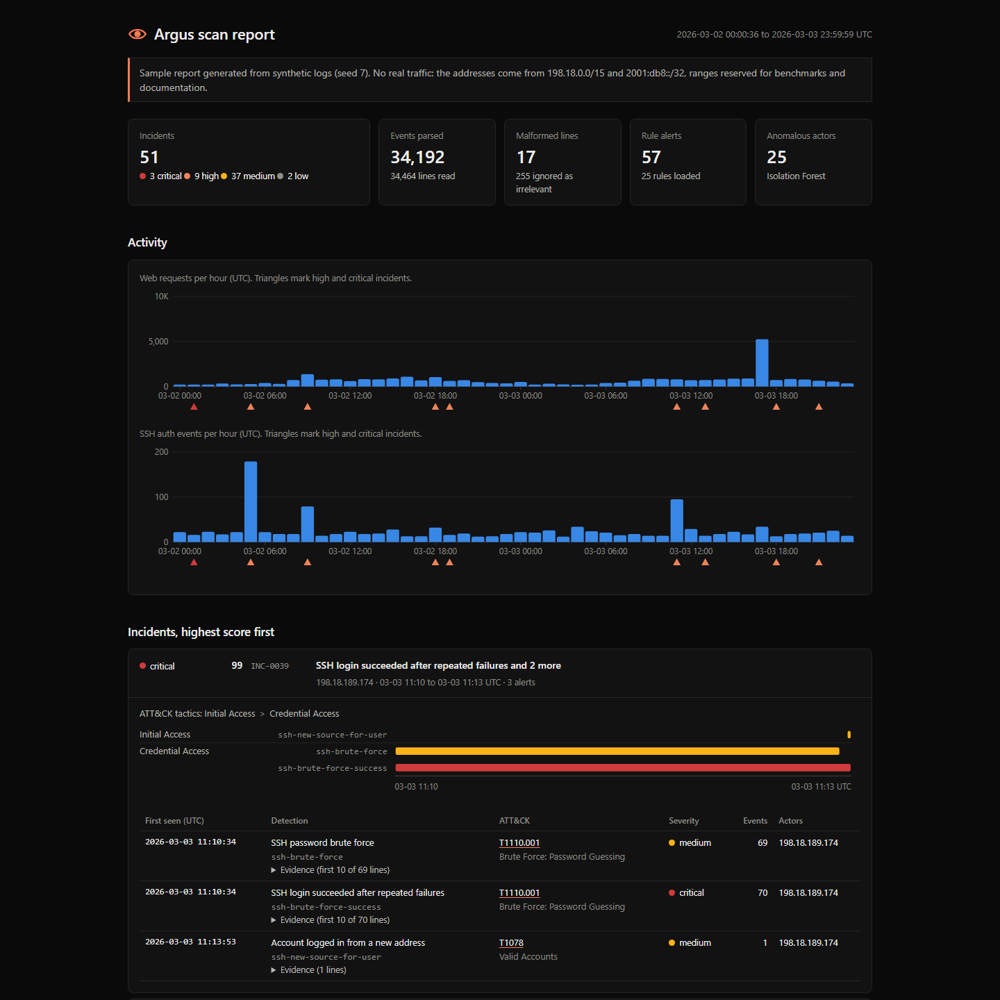

# Argus Threat Sentinel

[](https://github.com/TIENDUNG21/argus-threat-sentinel/actions/workflows/ci.yml)
[](LICENSE)

<p align="center"></p>

Argus reads nginx/Apache access logs and OpenSSH auth logs, runs 25 detection
rules mapped to MITRE ATT&CK plus an Isolation Forest over per-client
behaviour, and groups what it finds into scored incidents.

```
$ argus simulate --seed 7 --out logs
wrote 32,975 access lines, 1,489 auth lines (17 deliberately malformed) and labels for 779 actors (165 malicious) to logs
$ argus scan logs/access.log logs/auth.log --html report.html --json report.json --top 6
argus 1.0.0: 2 input(s), 34,464 lines, 34,192 events, 17 malformed, 255 ignored
window: 2026-03-02T00:00:36Z to 2026-03-03T23:59:59Z
rules: 25 loaded, 57 alerts
anomaly model (web): 625 actors scored, 25 flagged at 0.60

51 incidents (3 critical, 9 high, 37 medium, 2 low)

ID        LEVEL    SCORE  START (UTC)  ACTORS                  TITLE
INC-0039  critical    99  03-03 11:10  198.18.189.174          SSH login succeeded after repeated failures and 2 more
INC-0006  critical    82  03-02 01:38  198.18.73.37            Credential-bearing file served successfully and 1 more
INC-0014  critical    82  03-02 09:04  198.19.249.10           Script executed from an upload directory and 1 more
INC-0015  high        72  03-02 09:04  198.18.226.124          HTTP request flood and 6 more
INC-0013  high        70  03-02 05:28  198.19.43.157           Cloud metadata request through the site (SSRF)
INC-0027  high        70  03-02 19:47  198.18.7.56             Script executed from an upload directory
... 45 more in the HTML and JSON reports

malformed lines (skipped): bad timestamp 8, not combined log format 8, not syslog format 1
```

The logs above are synthetic (see [Accuracy](#accuracy)). The HTML report from
this exact run is published as the [sample report](https://tiendung21.github.io/argus-threat-sentinel/).
It is a single file with inline CSS and SVG and no JavaScript, so it can be
attached to a ticket or opened from disk.

[](https://tiendung21.github.io/argus-threat-sentinel/)

## Usage

Argus needs Python 3.11 or later and NumPy. It is not on PyPI; install the
tagged release from this repository:

```
pip install "git+https://github.com/TIENDUNG21/argus-threat-sentinel@v1.0.0"
```

```
argus scan PATH... [--html FILE] [--json FILE] [--fail-on LEVEL] [--rules FILE]...
                   [--no-builtin] [--no-ml] [--ml-sources web,ssh] [--format auto|combined|sshd] [--year N]
argus tail PATH [--from-start] [--format ...] [--rules FILE]...
argus rules list | check FILE...
argus simulate --out DIR [--seed N] [--hours H] [--visitors N]
```

The format is detected per file and `.gz` files are read directly. Syslog
timestamps carry no year; Argus infers it (a December log read in January
belongs to last year) unless `--year` says otherwise. Exit status is 0 on
success, 1 when `--fail-on` is given and an incident reaches that level, and 2
for unreadable input or an invalid rule file, which makes a nightly
`argus scan ... --quiet --fail-on high` usable as a cron or CI check.

`argus tail` follows a growing file through the same rule engine, survives
`logrotate` (rename or `copytruncate`) and prints each alert when it opens.
Replaying the simulated auth log from the start (run on Windows, hence the
backslash):

```
$ argus tail logs/auth.log --from-start
argus: following logs\auth.log (sshd, 25 rules); Ctrl-C to stop
2026-03-02T03:21:34Z  low       ssh-banner-scan  198.19.157.16  SSH banner grabbing (3 events, T1595.001)
2026-03-02T05:28:31Z  medium    ssh-max-auth-exceeded  198.18.60.157  SSH maximum authentication attempts exceeded (1 event, T1110.001)
2026-03-02T05:28:38Z  medium    ssh-brute-force  198.18.60.157  SSH password brute force (10 events, T1110.001)
2026-03-02T09:28:00Z  medium    ssh-password-spray  198.19.205.220  SSH password spraying (9 events, T1110.003)
2026-03-02T09:31:30Z  low       ssh-banner-scan  198.18.141.168  SSH banner grabbing (3 events, T1595.001)
2026-03-03T02:36:34Z  medium    ssh-new-source-for-user  198.19.25.169  Account logged in from a new address (1 event, T1078)
2026-03-03T11:10:57Z  medium    ssh-brute-force  198.18.189.174  SSH password brute force (10 events, T1110.001)
2026-03-03T11:13:53Z  critical  ssh-brute-force-success  198.18.189.174  SSH login succeeded after repeated failures (70 events, T1110.001)
```

## How it works

**Parsing.** Every input line is accounted for as parsed, ignored or
malformed, and malformed lines are counted by reason with samples kept for the
report. A log is attacker-controlled input, so the parsers are property-tested
with Hypothesis on arbitrary text, and the reader is tested with invalid UTF-8,
NUL bytes, CRLF, a 1 MB line and a truncated gzip stream. Request targets are
percent-decoded until they stop changing, so `%252e%252e%252f` reaches the
rules as `../`.

**Rules.** Detections are TOML files with conditions in a small typed
language, for example `status >= 400 and path ~ "\.php$"`. A hand-written
lexer, parser and compiler turn each condition into a Python closure and
reject unknown fields, type mismatches and invalid regular expressions when the
file is loaded. A typo in a detection rule otherwise produces a rule that never
fires, which is indistinguishable from a quiet network. Three rule kinds cover
the built-in set: sliding-window thresholds (on counts or distinct values),
ordered sequences, and first-seen values after a learning period. Alerts are
episodes: a brute force of 5,000 attempts is one alert with `count = 5000`,
not 5,000 alerts.

**Anomaly model.** Each client address becomes a row of behaviour features
(request rate, distinct paths, path entropy, error ratio, mean response size,
night-time share, POST ratio). An Isolation Forest (Liu, Ting and Zhou, 2008),
written with NumPy, scores how easily each row is isolated. Every score is
explained by crediting each split on the actor's path with
`log2(parent_size / child_size)` bits, so the report says *error_ratio 0.895
(typical 0), 26% of the isolation* rather than a bare 0.72. Only web clients
are modelled by default: on an exposed SSH port most addresses are attackers,
the model's "anomalies are rare" premise fails, and it measurably ranks the
administrators as the outliers.

**Incidents.** Alerts and anomalies that share a client address within two
hours form one incident; an alert naming several addresses (credential
stuffing) links them, so grouping is a union-find. The score starts from the
worst alert's severity, adds points for each further ATT&CK tactic reached and
for the number of alerts, and caps anomaly-only incidents at medium.

[docs/ARCHITECTURE.md](docs/ARCHITECTURE.md) walks through each stage. The
decisions with real alternatives are recorded as ADRs: [the rule
language](docs/adr/0001-rule-dsl.md), [the forest](docs/adr/0002-isolation-forest-from-scratch.md),
[episode alerts](docs/adr/0003-episode-alerts.md) and [synthetic
evaluation](docs/adr/0004-synthetic-evaluation.md).

## Rules

The 25 built-in rules cover SSH brute force, password spraying, a success
after failures, root and new-source logins and banner scans; web scanners,
wordlist scans and secret-file probes; SQL injection, XSS, path traversal,
command injection, SSTI, Log4Shell, Shellshock and cloud-metadata SSRF
probes; web shells, login brute force, distributed credential stuffing and
request floods. [docs/RULES.md](docs/RULES.md) lists each with its ATT&CK
technique and logic, and documents the language. A custom rule:

```toml
[[rule]]
id = "wp-admin-from-outside"
title = "WordPress admin reached"
severity = "medium"
technique = "T1190"
source = "web"
when = 'path startswith "/wp-admin" and stauts == 200'
```

```
$ argus rules check my-rules.toml
argus: my-rules.toml: rule 'wp-admin-from-outside': when: column 33: unknown field 'stauts' (did you mean 'status'?); known fields: action, auth_method, bytes, ext, host, hour, invalid_user, ip, method, path, port, protocol, query, referrer, source, status, target, uri, user, user_agent
```

## Accuracy

Measured on **synthetic** logs from the built-in simulator: ten 48-hour runs
(seeds 100-109) of a small shop with crawlers, monitors, an office NAT, SSH
administrators who mistype and travel, and 23 attack scenarios. Some scenarios
are built to slip under the rules (low-and-slow pacing, SQL injection outside
the usual patterns) and still count as expected detections. Thresholds were
tuned on seeds 1-5. The numbers show that the detectors do what they were
designed to do; they are not a prediction for a production network, whose
benign traffic is more varied than anything simulated.

| Detector | Precision | Recall | Notes |
|---|---:|---:|---|
| 25 rules, per actor (micro-average) | 98.3% | 97.7% | 750 expected detections, 14 rule hits on benign actors |
| Isolation Forest, web clients | 80.4% | 100.0% | ROC-AUC 0.998 over 6,277 actors |
| Isolation Forest, SSH clients (off by default) | 64.9% | 12.3% | ROC-AUC 0.083 |

Of the 17 missed detections, 14 come from the deliberately evasive variants
(slow directory scans, slow SSH and login brute forcing, SQL injection outside
the patterns) and 3 are addresses in plain credential-stuffing runs. Thirteen
of the 14 benign hits are administrators logging in from a new address; the
other is an administrator logging in as root.
[docs/EVALUATION.md](docs/EVALUATION.md) has the per-rule table and the misses
by scenario; it is generated by `scripts/evaluate.py`, and CI fails if
regenerating it on Linux changes a byte.

## Performance

A full scan of a 48-hour simulation with 6,000 visitors a day (381,094 lines,
12,029 web clients modelled) takes 15.7 s on one core of an Intel i7-14700K
(32 GB RAM, Windows 11, Python 3.13), about 24,000 lines per second. The rule
engine is half of that and parsing a third; both are pure Python and cost a
roughly constant amount per line. The whole anomaly stage (features, 200
trees on 256-row subsamples, scores and attributions for 12,029 actors) takes
0.96 s. The machine was
shared with other jobs while measuring. [docs/BENCHMARKS.md](docs/BENCHMARKS.md)
has the per-stage table, produced by `scripts/bench.py`.

## Limitations

- Two formats only: combined/common access logs and OpenSSH syslog messages.
  No JSON access logs, no journald export, no Windows or cloud provider logs.
- An actor is a client address. Behind a reverse proxy or CDN, the access log
  must record the real client address (nginx `real_ip_header`, Apache
  `mod_remoteip`), or every
  request looks like one actor. Users behind one NAT look like one actor too.
- Access logs carry no request bodies and few headers, so POST payloads and
  cookie or header-based attacks are invisible.
- Thresholds are per address and per window. Attacks paced below them are
  missed by design, as the evaluation shows.
- Nothing persists between runs. New-value rules relearn from the start of
  every scan, and `argus tail` loses its state when restarted.
- The anomaly model is batch only and also flags unusual benign clients
  (monitors, crawlers), which is why its findings score lower than rules.
- Custom rules use Python's backtracking regular expressions; a pathological
  pattern can be slow on a crafted line. See [SECURITY.md](SECURITY.md).

## Roadmap

Not in 1.0, in rough order of value: an allowlist file for known monitors and
scanners; persisted baselines so new-value rules and the anomaly model can
learn across runs; JSON access logs and journald export; importing the subset
of Sigma rules that maps onto these two log schemas; parsing on several cores.

## Building from source

```
git clone https://github.com/TIENDUNG21/argus-threat-sentinel
cd argus-threat-sentinel
python -m venv .venv && . .venv/bin/activate    # .venv\Scripts\activate on Windows
pip install -e ".[dev]"
ruff check . && ruff format --check . && mypy && pytest
python scripts/evaluate.py --check              # docs/EVALUATION.md is reproducible
python scripts/build_site.py --out site         # the sample report
```

The suite has 409 tests: a positive and a near-miss negative case for every
built-in rule, Hypothesis properties for the parsers, the condition language,
the sliding-window engine (checked against a brute-force oracle) and the
forest, malformed-input cases for the reader, and end-to-end runs of the CLI
on simulated logs. One test (log rotation by rename) is skipped on Windows,
which cannot rename an open file; it runs in CI on Linux with Python 3.11,
3.12 and 3.13.

## References

- F. T. Liu, K. M. Ting, Z.-H. Zhou. *Isolation Forest.* Proc. 8th IEEE
  International Conference on Data Mining (ICDM), 2008, pp. 413-422.
- B. E. Strom, A. Applebaum, D. P. Miller, K. C. Nickels, A. G. Pennington,
  C. B. Thomas. *MITRE ATT&CK: Design and Philosophy.* The MITRE Corporation,
  2018, revised 2020.
- J. A. Hanley, B. J. McNeil. *The meaning and use of the area under a receiver
  operating characteristic (ROC) curve.* Radiology 143(1), 1982, pp. 29-36.
- RFC 2544 and RFC 3849 (the 198.18.0.0/15 and 2001:db8::/32 ranges used by
  the simulator), RFC 5737 (documentation addresses in simulated payloads),
  RFC 3164 and RFC 3339 (syslog and timestamp formats).

## Data and credits

Technique ids and names come from [MITRE ATT&CK](https://attack.mitre.org/),
used under its [terms of use](https://attack.mitre.org/resources/legal-and-branding/terms-of-use/).
© The MITRE Corporation. ATT&CK is a registered trademark of The MITRE
Corporation. No third-party log data is used or distributed.

## License

MIT, see [LICENSE](LICENSE).
