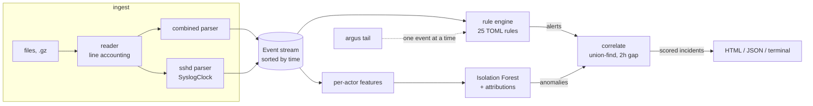

# Architecture

Argus is a batch pipeline with one streaming component. Log lines become
immutable `Event`s; two independent detectors look at the same events; their
findings are merged into incidents and rendered.

Package layout (`src/argus`):

| Package | Responsibility |
|---|---|
| `ingest` | Decode bytes, split lines, parse two formats, account for every line, follow growing files |
| `rules` | Condition language (lexer, parser, type-checking compiler), TOML loader, streaming engine and detectors |
| `ml` | Per-actor feature matrices, Isolation Forest, per-feature attributions, the detector that ties them together |
| `correlate` | Group alerts and anomalies into incidents, score them 0-100 |
| `report` | Self-contained HTML (inline CSS and SVG), JSON schema 1, terminal summary |
| `simulate`, `evaluation` | Seeded labelled traffic and per-actor precision/recall against it |
| `pipeline`, `cli`, `live` | Wiring for `argus scan`, the command line, and `argus tail` |

Runtime dependencies are the standard library and NumPy. Rules are parsed with
`tomllib`; the forest, the charts and the HTML are written here.

## Ingest

Every input line ends in exactly one bucket: **parsed** (it produced an
event), **ignored** (blank, or well-formed but not something Argus models,
such as a cron line in `auth.log`) or **malformed** (counted by reason, with the
first samples kept for the report). Parsers raise `MalformedLineError(reason)`;
the reader catches only that type, so a bug in a parser surfaces in tests
instead of being silently counted. Hypothesis tests feed arbitrary text to
each parser and assert that nothing else ever escapes.

Bytes are decoded as UTF-8 with invalid sequences replaced, lines longer
than 64 KiB are cut and counted as malformed, NUL bytes and CRLF endings
are tolerated, and gzip input is read transparently. A truncated gzip stream
keeps the events read before the damage and records an error.

`Event` is a frozen, slotted dataclass shared by both sources. Web events carry
the request split into `path`, `query`, `ext` and a `uri` that has been
percent-decoded until it stops changing, so `%252e%252e%252f` becomes `../`
before any rule sees it.

Traditional syslog timestamps have no year and no zone. `SyslogClock` assumes
the current year, steps back one year if the first line would lie more than two
days in the future (reading December's log in January), and advances the year
when the month jumps backwards by more than six (a log spanning New Year).
An impossible date, such as February 29 of a non-leap year, is counted as a
malformed line. RFC 3339 timestamps from modern rsyslog are used as written.

## Rules

A rule is a TOML table with a `when` condition and a kind (`threshold`,
`sequence` or `new_value`); [RULES.md](RULES.md) is the reference.

The condition language is compiled in three steps. The lexer produces tokens
with column numbers and treats string literals as raw, so regular expressions
need no double escaping. A recursive-descent parser builds a small syntax tree
(`not` > `and` > `or`). The compiler walks the tree once with the field schema
in hand and returns a Python closure; this is where type errors are caught:
unknown fields (with a "did you mean" suggestion from `difflib`), ordering
operators on text, regular expressions on numbers, invalid patterns, literals of
the wrong type. A rule file with a typo fails to load with the file, rule id and
column, which matters more for a detection tool than for most software: a rule
that silently never matches looks exactly like a quiet network.

The engine is streaming. `Engine.process(event)` routes the event to the
detectors of its source, evaluates each rule's compiled condition, and lets the
matching detectors update their per-group state:

- **Threshold** keeps a deque of recent matching events per group (by default
  per client address) and a counter of distinct values when `distinct` is set.
  It fires when the window holds `count` events or values.
- **Sequence** keeps the first step in a sliding window and the later steps as
  a cursor. A brute force that runs for hours and finally succeeds is still
  linked to the success, because the step-one window always holds the most
  recent failures.
- **New value** learns the values a group shows during `learn`, then fires on
  the first unseen one.

Alerts are **episodes**: after a rule fires for a group, further matching
events extend the same alert (count, last timestamp, distinct actors, the first
ten evidence lines) until the group stays quiet for longer than the window.
That keeps a 5,000-attempt brute force as one alert with `count = 5000`. Every
10,000 events the engine sweeps state that can no longer contribute to an
alert, so memory stays bounded by the number of active groups rather than the
length of the log. ADR [0003](adr/0003-episode-alerts.md) has the reasoning.

The same engine object serves `argus scan` (all events, sorted by time) and
`argus tail` (one event at a time as lines are appended).

## Anomaly model

Rules only see what someone wrote a rule for. The anomaly model looks for
actors whose overall behaviour is unusual compared with everyone else in the
same log.

`ml/features.py` aggregates events per client address into one row. Web
actors get eight features (requests, rate per minute, distinct paths, path
entropy, error ratio, mean response bytes, share of requests between 00:00 and
06:00 UTC, POST ratio); SSH actors get six. No standardisation is needed: an
Isolation Forest split is drawn uniformly between a feature's minimum and
maximum inside the node, so scaling a feature by a constant changes nothing.
A non-linear transform does change where splits land, which is why
heavy-tailed counts go through `log1p`: without it, one actor with 50,000
requests would absorb most splits on that feature.

`ml/iforest.py` implements Isolation Forest (Liu, Ting and Zhou, 2008): 200
trees, each grown on a 256-row subsample to height `ceil(log2(256)) = 8`. Trees
are stored as flat NumPy arrays (feature, threshold, children, node size), so
scoring pushes every actor down a tree one level per vectorised step instead of
recursing per point. The score is `2 ** (-E[h(x)] / c(n))`; the default flag
threshold is 0.6.

An anomaly score alone is not actionable, so `ml/explain.py` attributes it to
features. Along an actor's path, each split shrinks the set of training rows
sharing its node; a split that takes the node from 256 rows to 1 did most of the
isolating. Each split credits its feature with `log2(parent_size / child_size)`
bits, summed over all trees and normalised to shares. The report shows the top
three features with the actor's value next to the median: "error_ratio 0.895
(typical 0), 26% of the isolation".

Only web actors are modelled by default. On an internet-facing SSH port most
addresses are attackers, so the model's premise (anomalies are few) does not
hold and it isolates the administrators instead; the evaluation measures this
(ROC-AUC 0.083 on SSH actors). ADR [0002](adr/0002-isolation-forest-from-scratch.md).

## Incidents

`correlate` groups alerts that share an actor and start no later than two hours
after that actor's activity so far ended. A credential-stuffing alert names
forty addresses, which links those addresses together, so grouping is a
union-find over alerts rather than a per-address loop. Anomalies join the
incident of their actor when their time span overlaps it within the gap;
otherwise they become anomaly-only incidents.

The score (`correlate/scoring.py`) starts from the highest alert severity
(low 15, medium 35, high 60, critical 85), adds 8 per additional ATT&CK tactic
(progress along the kill chain), `4 * log2(alerts)` for breadth, and 10 when the
anomaly model also flagged one of the actors. Anomaly-only incidents score
`50 * score` and can never exceed medium: a statistical outlier without a
matching rule is a lead, not a finding. The timeline in the report gives every
alert its own lane, grouped by tactic in ATT&CK order.

## Reports

The HTML report is one file with inline CSS and inline SVG and no JavaScript.
Every value from a log goes through `html.escape`, and a
`Content-Security-Policy` meta tag (`default-src 'none'; style-src 'unsafe-inline'; img-src data:`)
forbids scripts and remote loads. Collapsible evidence uses `
`, chart
tooltips use SVG `<title>`. A test plants markup in a request and in a
malformed line, parses the resulting page and checks that it contains no
`script` element, no injected tag and no `on*` attribute.

The JSON report (schema version 1) lists alerts once and lets incidents refer
to them by id. Lists are sorted and `generated_at` honours
`SOURCE_DATE_EPOCH`, so two scans of the same input produce identical files.

## Simulation and evaluation

`simulate(seed)` writes an nginx access log, an OpenSSH auth log and
`labels.json` for 48 hours of a small online shop. Everything random comes
from one `random.Random(seed)`, so a seed always gives byte-identical files.
Addresses come from 198.18.0.0/15 (RFC 2544) and 2001:db8::/32 (RFC 3849);
benign and malicious actors draw from the same pool. Benign traffic includes
the cases that trip naive rules (SQL-sounding searches, crawlers, an uptime
monitor, an office NAT, admins who mistype, a travelling admin). Attack
scenarios include low-and-slow and evasive variants whose labels still name
the rule that should catch them, so the misses are counted.

`scripts/evaluate.py` scans seeds 100-109 and writes
[EVALUATION.md](EVALUATION.md); CI regenerates it and fails if it differs.
Thresholds were tuned on seeds 1-5 only. ADR [0004](adr/0004-synthetic-evaluation.md)
covers why synthetic data, and what it cannot show.

## Live mode

`argus tail` follows one file like `tail -F`. The follower keeps the file
handle open, so after a rename-style rotation it drains what the server still
wrote to the old file before switching; a file that shrinks below the read
offset (`copytruncate`) is read again from the start. Only rules run live: the
anomaly model needs the population of actors to say what is unusual.

## Determinism

Three properties are tested because the evaluation and the sample site depend
on them: the simulator is byte-identical per seed, the forest is identical per
seed, and the JSON report is identical for identical input when
`SOURCE_DATE_EPOCH` is set. CI exercises the first two by regenerating
`docs/EVALUATION.md` on Linux and comparing it with the copy produced on
Windows.
